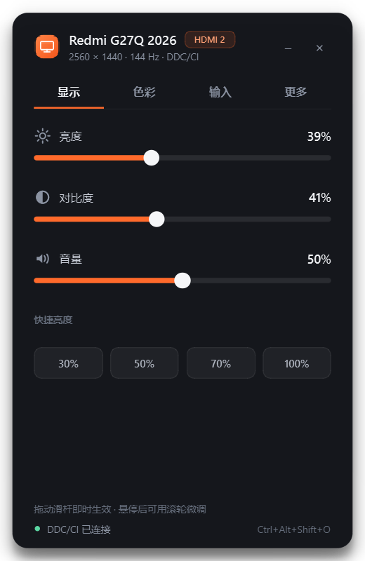
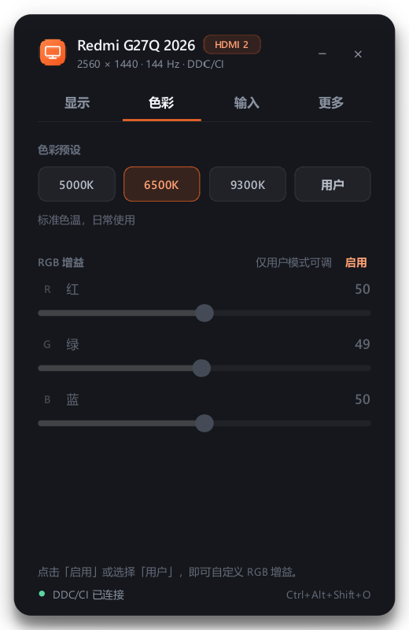
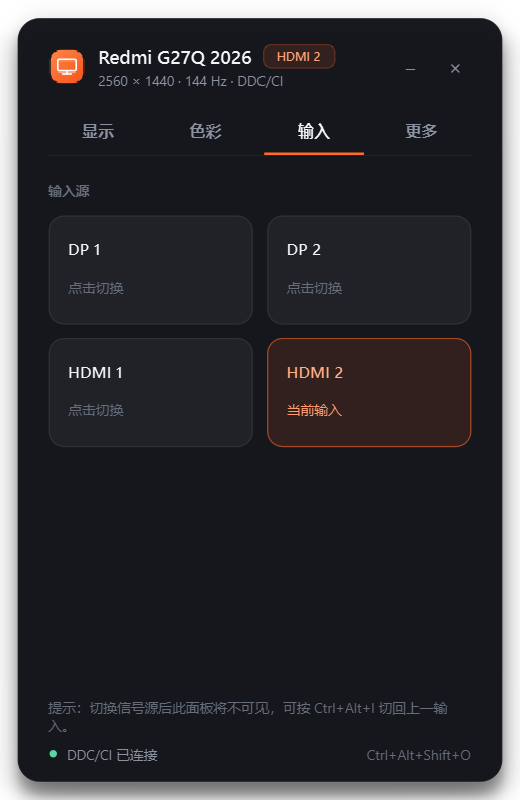
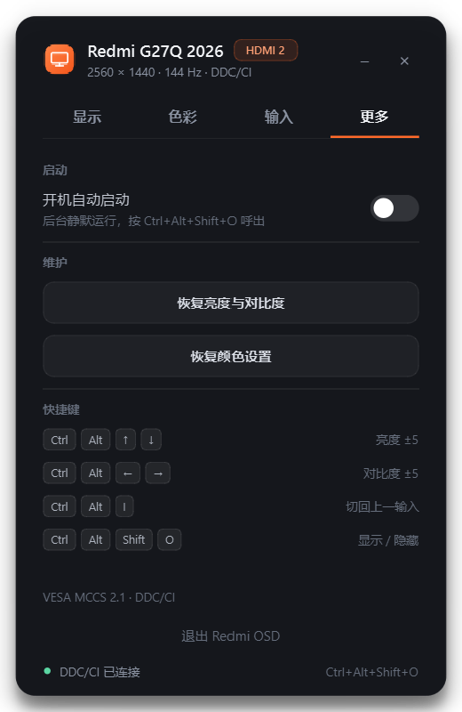

# Redmi OSD — Redmi G27Q 2026

Windows 11 桌面 OSD：用 PyQt6 把显示器菜单搬到桌面上，通过 DDC/CI 直接控制，不模拟按键、不依赖厂商软件。为“实体按键太远”的场景设计。

## 界面

| 显示 | 色彩 |
| :---: | :---: |
|  |  |
| **输入** | **更多** |
|  |  |

<p align="center">
  
</p>

> 截图取自 2560 × 1440、Windows 缩放 125%；迷你 OSD 会在调亮度/对比度时短暂出现。

## 功能

- **显示**：亮度、对比度、音量滑杆；30% / 50% / 70% / 100% 快捷亮度。
- **色彩**：5000K / 6500K / 9300K / 用户 四档预设；RGB 增益仅在「用户」模式生效，点色彩页的橙色「启用」（或「用户」预设）即可解锁编辑。
- **输入源**：DP 1、DP 2、HDMI 1、HDMI 2；两次点击确认，切换后若面板不可见，可按 `Ctrl+Alt+I` 切回上一输入。
- **维护**：恢复亮度与对比度、恢复颜色设置；开机自启（后台静默）。
- **全局热键 + 迷你 OSD**：亮度/对比度步进、快速显隐面板。
- 单实例、无边框浮层、Win11 圆角深色界面、高 DPI 适配、滑杆 70ms 防抖、DDC/CI 异步读写不卡界面。

## 安装与启动

仓库不包含 `.venv`，首次使用先创建环境（需要 Python 3.13）：

```bat
py -3.13 -m venv .venv
.venv\Scripts\python.exe -m pip install -r requirements.txt
```

然后双击 **`启动 Redmi OSD.vbs`**（按自身所在目录定位，移动文件夹也不会失效），或运行：

```bat
.venv\Scripts\pythonw.exe main.pyw
```

想放桌面的话，可以右键 `启动 Redmi OSD.vbs` → 发送到 → 桌面快捷方式。程序为单实例，重复启动只会唤起正在运行的窗口。

### 平台支持

**仅支持 Windows 10/11**（Windows 11 实测）。`启动 Redmi OSD.vbs` 只是 Windows Script Host 启动器，用来无控制台启动 Python，不是应用本体，也不能在 macOS 上打开。DDC/CI 后端依赖 Win32 `dxva2.dll` / `user32.dll`，因此本项目没有 macOS 或 Linux 版本。

macOS 上控制外接显示器亮度/对比度可以考虑 [MonitorControl](https://github.com/MonitorControl/MonitorControl) 或 BetterDisplay（非本项目）。

## 快捷键

| 热键 | 作用 |
| --- | --- |
| `Ctrl+Alt+↑` / `↓` | 亮度 ±5（显示迷你 OSD） |
| `Ctrl+Alt+←` / `→` | 对比度 ±5（显示迷你 OSD） |
| `Ctrl+Alt+I` | 切回上一输入源 |
| `Ctrl+Alt+O` 或 `Ctrl+Alt+Shift+O` 或 `Ctrl+Alt+F10` | 显示 / 最小化面板（自动选用可注册的组合） |
| `Esc` | 最小化面板 |

测试环境里 `Ctrl+Alt+O` 已被其他程序占用，因此实际显隐热键是 **`Ctrl+Alt+Shift+O`**；界面底部和「更多」页会显示实际生效的组合。程序会按 `Ctrl+Alt+O` → `Ctrl+Alt+Shift+O` → `Ctrl+Alt+F10` 的顺序自动选择可用组合。

- 标题栏可拖动；`×` 退出应用，`−` 最小化（热键继续工作）。
- 开机自启会写入 `HKCU\Software\Microsoft\Windows\CurrentVersion\Run` 的 `RedmiOSD` 值，静默启动，用显隐热键呼出；应用内可关闭。
- 后台静默启动时没有托盘图标，再次运行启动器会唤起已运行的实例。

## 注意

- 显示器 OSD 中必须开启 **DDC/CI**。如果应用比显示器先启动导致连接失败，点击状态栏的「重试」即可，无需重启。
- **输入源切换有断屏风险**：切到另一个设备后，本面板在该显示器上不可见；若 DDC 仍可用，按 `Ctrl+Alt+I` 可切回。极端情况下请使用显示器实体按键。
- 「恢复亮度与对比度 / 恢复颜色设置」需要连续点击两次确认；前者会重置为该显示器的默认亮度/对比度（测试机为 60/75），后者会重置为 6500K。
- 音量控制取决于显示器的音频输出能力；无扬声器/耳机输出时无感。
- 界面副标题显示系统当前模式（当前为 2560 × 1440 · 144 Hz），不是面板标称最高刷新率。
- 仅针对 XMI 27B1（Redmi G27Q 2026）实测；其他支持 DDC/CI 的显示器通常可用，但可用项和输入源枚举可能不同。
- 仅支持 Windows 10/11；macOS / Linux 不能运行（`.vbs` 只是 Windows 启动脚本，DDC 后端是 Win32 API）。
- DDC/CI 只暴露标准 VCP（亮度、对比度、色彩、输入、音量）；响应时间、准星、帧率计等游戏项不在标准协议内，无法由本应用控制。

## 技术说明

- DDC/CI 通过 `dxva2.dll` 的 Win32 接口：`EnumDisplayMonitors`、`GetPhysicalMonitorsFromHMONITOR`、`GetCapabilitiesStringLength`、`GetVCPFeatureAndVCPFeatureReply`、`SetVCPFeature`。
- VCP 使用：`0x10` 亮度、`0x12` 对比度、`0x14` 色彩预设、`0x16/0x18/0x1A` RGB、`0x60` 输入源、`0x62` 音量、`0x05/0x08` 恢复默认（Redmi G27Q 2026 要求 value=1）。
- PyQt6 `QThread` 异步读写，UI 线程不阻塞；`WM_HOTKEY` 通过 `nativeEvent` 接收。
- 注意：PyQt6 6.9 下 `nativeEvent` 中调用 `super().nativeEvent()` 在本机会触发原生崩溃，因此未处理的消息直接返回 `(False, 0)`。
- 单实例用 `QLocalServer`；目标显示器通过 DDC 能力集与窗口位置自动选择。
- 无第三方 DDC 库、无 Electron、无 Win32 老式控件。

## 目录

```
main.pyw                 入口（DPI、单实例、主题、--silent / --screenshots）
redmiosd/
  app.py                 主窗口、页面、热键、状态同步
  monitor.py             Win32 DDC/CI 枚举、能力解析、QThread 工作线程
  widgets.py             自绘图标、滑杆、开关、输入卡片、迷你 OSD
  theme.py               配色、字体与 QSS
  autostart.py           HKCU Run 开机自启
tools/
  ddc_probe.py           读取显示器能力与 VCP 值（只读诊断）
  ddc_write_test.py      同值回写测试（不改变任何设置）
assets/                  图标
screenshots/             各页截图
```

## 参考与致谢

DDC/CI 桌面控制的产品思路参考了两个成熟开源项目，本项目的界面与代码均为原创实现，未复用其代码：

- [Twinkle Tray](https://github.com/xanderfrangos/twinkle-tray)
- [Monitorian](https://github.com/emoacht/Monitorian)

VESA MCCS / DDC/CI 协议来自 VESA 规范与 Windows `dxva2` 接口。

## License

[MIT](LICENSE) © 2026 cv-superding
